# Release v1.0.4 - Dual-Hook Architecture & Half-Press AF Freeze Fix

## 🎯 What's New in v1.0.4

### 1. Root Cause Resolution: The Half-Press AF Screen Freeze & Lockup
In v1.0.3, the camera booted into LiveView normally, but pressing the shutter button halfway (S1) to autofocus caused an immediate frozen screen and unresponsive camera that could only be recovered by pulling the battery.

Deep static reverse-engineering revealed the exact root cause:
- **Misidentified Symbol**: Virtual address `0x538e32c4` was previously hypothesized to be an autofocus tracking target updater (`UpdateTrackTarget`).
- **Static Proof**: Analysis of strings and structure references proved that `0x538e32c4` is actually `CreateTask` in `src/Task.cpp` (referenced string at `0x53fe1a4c` = `"CreateTask"`).
- **Rogue Task Execution**: When AI confidence reached $\ge 60$, our code invoked `0x538e32c4` twice per frame with outgoing stack argument $H = 180 = \text{0x000000b4}$ as the `TaskEntry` function pointer!
- **Exception Loop on S1**:
  - During normal LiveView preview, this task had a low priority (`945`) and was queued in the eSOL T-Kernel scheduler.
  - **The moment of S1 (half-press)**: The camera's main thread paused or yielded to await AF lens convergence. The RTOS scheduler switched context to this newly spawned rogue task at `0x000000b4` (inside ARM low-memory exception vectors). The CPU branched into garbage vector code, encountered an unhandled exception loop, hard-locked the ARM core, and froze the camera completely.
  - Furthermore, `CreateTask` attempts to acquire task mutex `[0x53fe18c8]` (`bl 0x538dfe24`), while `FaceDetectionService::Task` already held the mutex, creating an immediate deadlock.

---

### 2. The Architectural Solution: Clean Dual-Hook Separation
To ensure maximum stability, performance, and cleanliness, v1.0.4 implements an architectural **Dual-Hook** structure:

```mermaid
flowchart TD
    subgraph Boot["Boot Stage (One-Time Execution)"]
        A["LiveViewProcess3aContoller (0x536520f0)"] -->|Hook 1 Trampoline| B["Cave 1 (0x53000d60, 152 B)"]
        B -->|Reconstruct APCS Frame| C["DspFactory::GetDspService()"]
        C -->|LoadDsp 'A', Start, Test| D["CEVA-CV DSP Initialized from SD Card"]
        D -->|Resume at 0x53652108| E["Normal Camera Boot Continues"]
    end

    subgraph LiveView["Continuous LiveView Framing (30/60 fps)"]
        F["FaceDetectionService::Task (0x5386ea8c)"] -->|Hook 2 Trampoline| G["Cave 2 (0x53000e00, 692 B)"]
        G --> H{"DSP Started?"}
        H -->|No| Fallback["Fallback to FotoNation LibAHFD (0x5383ec84)"]
        H -->|Yes| I["Decimate (Every 2nd Frame)"]
        I --> J["Downsample 960x640 -> 56x56 RGB @ 0x51600000"]
        J --> K["DspService::SendMessage(msg_id=4) & WaitMessage(50ms)"]
        K --> L{"Heatmap Peak >= 60?"}
        L -->|No| Fallback
        L -->|Yes| M["Populate m_DetectedFaceResult & face_count=1"]
        M -->|ZERO CreateTask calls!| N["Resume at 0x5386ea9c (Unlock Mutex)"]
        N --> O["UpdateFaceDetectionResult (0x5386e0e4)"]
        O --> P["Green AI Box on LCD + 165-Point On-Sensor PDAF Lock!"]
        Fallback -->|Resume at 0x5386ea94| Q["Stock AF Routine"]
    end
```

1. **Hook 1 (Boot Wakeup @ `0x536520f0` -> Cave 1 @ `0x53000d60`, 152 B)**:
   - Reconstructs APCS prologue and calls `LoadDsp('A')`, `Start()`, `Test()` safely **once at boot time** outside of any per-frame lock.
   - Tested and verified 100% stable on real hardware in Stage 2.
2. **Hook 2 (Continuous LiveView AI AF @ `0x5386ea8c` -> Cave 2 @ `0x53000e00`, 692 B)**:
   - Evaluates neural inference via shared DRAM DMA and message passing.
   - Injects subject coordinates & eye landmarks directly into `m_DetectedFaceResult` (`[r4, #0x78]`).
   - Sets `face_count = 1` in `FdLibraryService` (`[r4, #0x38]`).
   - **Completely removes all calls to `0x538e32c4` (`CreateTask`)**.
   - Resumes natively at `0x5386ea9c`, cleanly unlocking the mutex and calling `UpdateFaceDetectionResult` (`0x5386e0e4`) to render the green tracking box and steer the 165-point on-sensor AF engine!

---

## 📦 Binary Assets Included

| File | Size | SHA-256 | Description |
| :--- | :--- | :--- | :--- |
| `fwdc248b.bin` | 38,791,732 B | `edd0aa6184f03b6c75ccd1fd23408fd8fe521e073e4f69b4d520cb8a14cc24fc` | Active flashable Stage 3 v1.0.4 firmware (copy to SD root) |
| `fwdc248b_stage3_ai_track.bin` | 38,791,732 B | `edd0aa6184f03b6c75ccd1fd23408fd8fe521e073e4f69b4d520cb8a14cc24fc` | Preserved Stage 3 v1.0.4 firmware |
| `fwdc248b_stage2_dsp_wake.bin` | 38,693,256 B | `ed8c4e2414ffd66e270bb308a3d3c932a4de8300e57e6cc0fb1fc8f0fffd836e` | Verified Stage 2 DSP awakening baseline |
| `DF_EX.BIN` | 4,112,408 B | `276d6a8196c61563307ddbf01fd568408b594f6733c3ccb43bd0a83d5ac98d84` | CEVA-CV vector math core (copy to SD root) |
| `DF_ID_S.BIN` | 65,536 B | `3d3ebf29622323bb4a203347feaf676aeac110a7b1181604270a1ae0c22b0a2a` | CNN model weights table (copy to SD root) |
| `DF_IP.BIN` | 16,384 B | `cf409a84f3f2d8fac1491634ecda882c9d76b3439c2423da1b31950463a52067` | Reset & boot vectors (copy to SD root) |
| `dsp_stage3_manifest.json` | - | - | Complete verification manifest & disassembly dump |
